# Glass TV — Clean English Edition

<p align="center">
  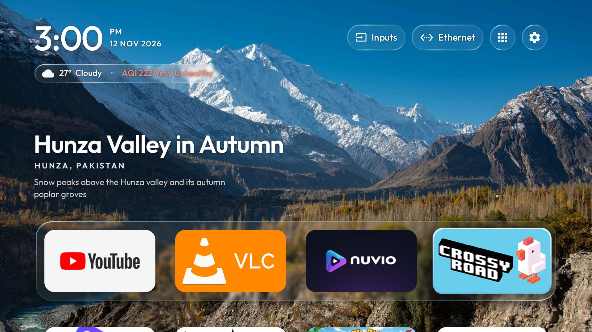
</p>

**A quiet, ad-free Android TV launcher in frosted glass — English UI, weekly places, and a phone upload page that stays connected.**

<p align="center">
  <a href="https://github.com/5uleman/glass-tv-home/releases/tag/v4.0.1"></a>
  
  
  
</p>

> **A fork.** This is [5uleman](https://github.com/5uleman)'s modified fork of
> [glass-tv-home](https://github.com/aqmangge/glass-tv-home) by Gathin ([@aqmangge](https://github.com/aqmangge)),
> used under the MIT licence. It is not endorsed by or affiliated with the original author, and comes with no
> support promise. The original project and its history belong to the original author; the changes in this fork are listed below.

## What's different from upstream

- **English only.** `AppLanguage` reports English whatever the TV's language is; the Malay and Indonesian strings
  stay in the code but are never selected.
- **No prayer or Azan.** `PrayerTimes.PRAYER_DISABLED` is on, so there is no waktusolat fetch, no azan popup or
  recording, no Islamic shelf, and the nightstand clock keeps its time and date but drops the prayer and Hijri rows.
- **No Gemini assistant.** The Gemini row is removed from the settings menu.
- **Lahore by default.** Weather starts at Lahore, Pakistan (31.5204, 74.3587, station `PK01`, Asia/Karachi).
  A location you choose on the TV still wins.
- **No self-updater.** `AppUpdateManager.UPDATES_ENABLED` is off: no release feed is read and no update prompt appears.
- **Four or five apps per row.** The wallpaper settings cycle 4 → 5 → 4; a stored six-column choice becomes five.
- **Its own package and key.** The id is `com.suleman.glasstv` and it is signed with this fork's key, so it installs
  beside the upstream build rather than updating it.

## Highlights

| | |
|---|---|
| **Two Pakistan collections.** | *Attractions in Pakistan* has 24 photos of Lahore, Islamabad, Karachi, the forts and the mosques; *Nature in Pakistan* has 10 from Hunza, Attabad Lake, Nanga Parbat, Swat, the Karakoram, Rawal Lake and Clifton Beach. |
|  | **Day and night rotation.** With Day/Night on, 06:00–18:00 rotates day and both-tone photos, and 18:00–06:00 rotates night and both-tone photos. Uploaded and pinned photos are never filtered. |
| 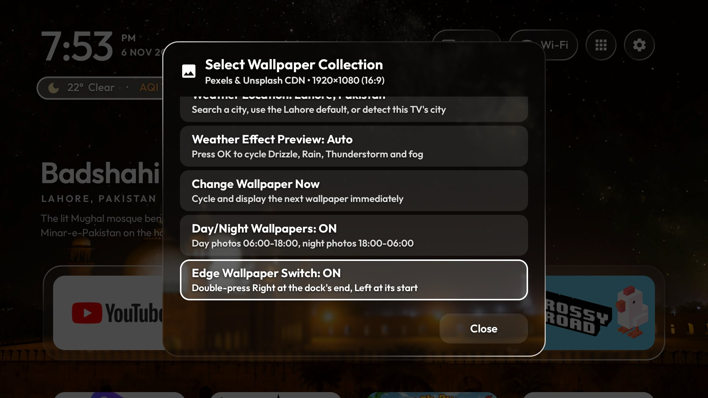 | **Edge wallpaper switching.** At the last dock tile, double-press Right (at the first tile, Left) to change the wallpaper. The system toast explains the second press, twice per side. In No wallpaper mode the switch is off: those keys do nothing. |
| 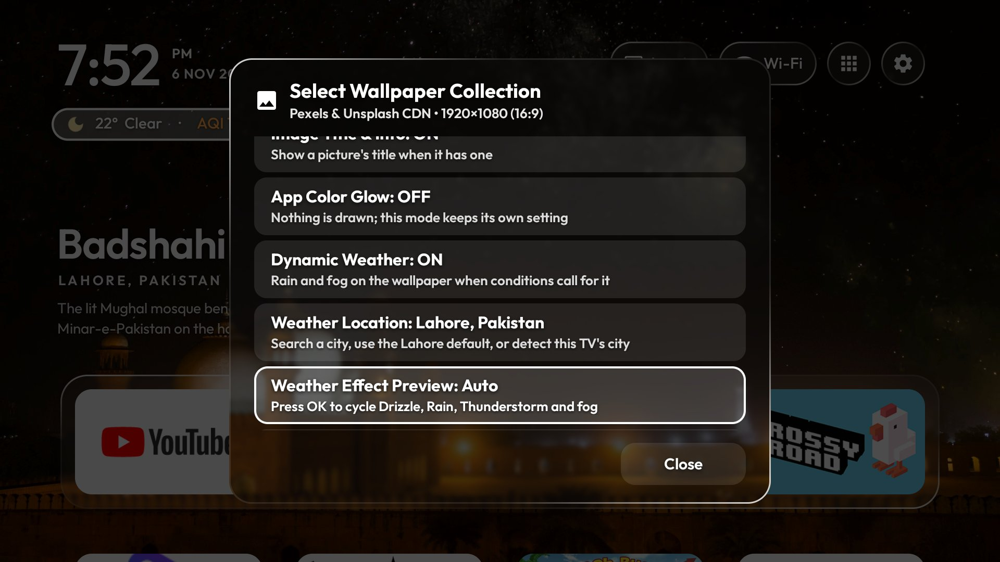 | **Weather on the wallpaper.** Rain, drizzle, thunderstorms and drifting fog come from the real forecast; the preview row cycles every effect, and the location row finds any city. |
| 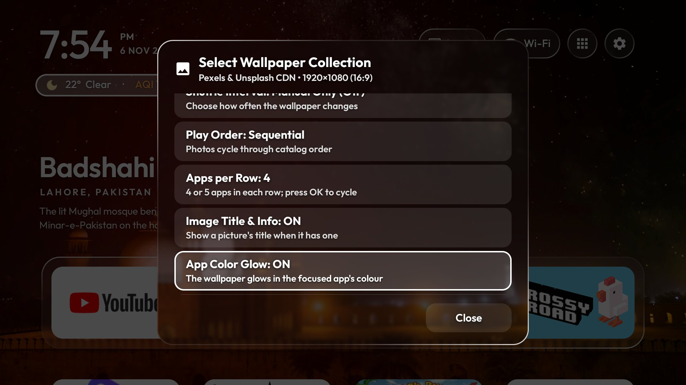 | **App-colour glow.** The wallpaper glows in the focused app's colour, rasterised at the screen's own size and cross-faded over 450 ms. The switch is per mode. |
| <svg width="28" height="28" viewBox="0 0 24 24" fill="none" stroke="#3B82F6" stroke-width="1.75" stroke-linecap="round" stroke-linejoin="round"><path d="M12 16.5V4m0 0L8 8m4-4 4 4M4.5 19.5h15"/></svg> | **Send photos from your phone.** Open the QR code on the TV, scan it once, and send up to 10 photos from the phone page. The page stays connected while the window is open. |

## Screenshots

Screenshots from an Android TV at 1920×1080, captured on 12 November 2026 with the 4.0.0 build (version code 26).
The ring, rim and glow look is unchanged in 4.0.1, except that No wallpaper mode and gray or dark pictures now
use a neutral glare instead of the classic blue.

| | |
|---|---|
| 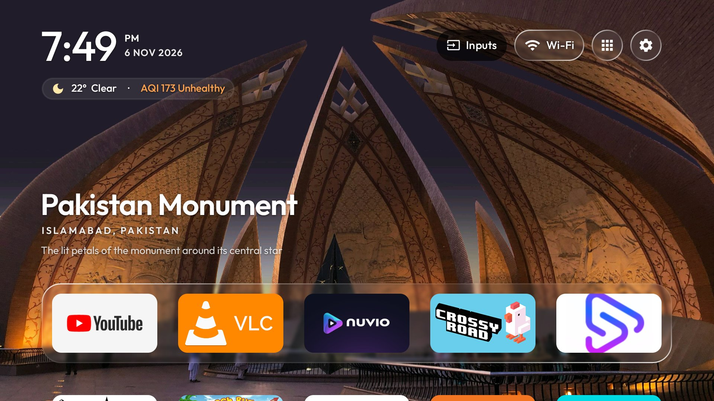<br>*Home with five columns* | 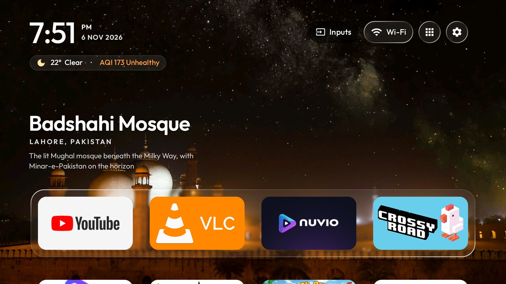<br>*Badshahi Mosque at night* |
| 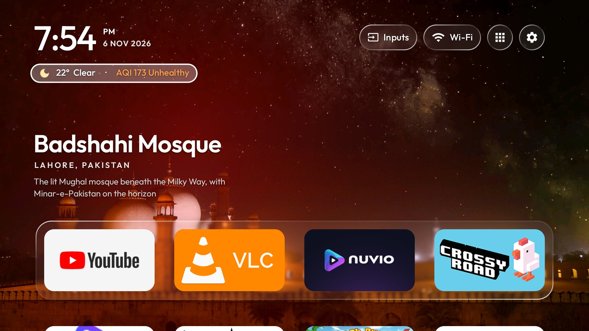<br>*The app-colour glow over Badshahi Mosque* | 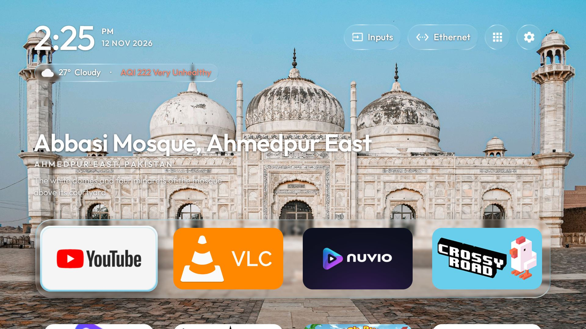<br>*Attractions in Pakistan* |
| 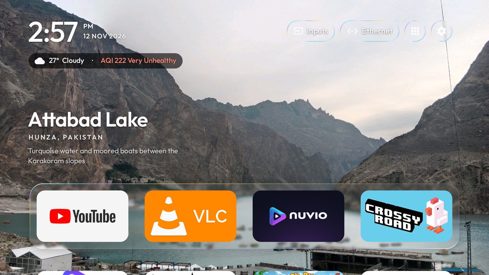<br>*Nature in Pakistan* | 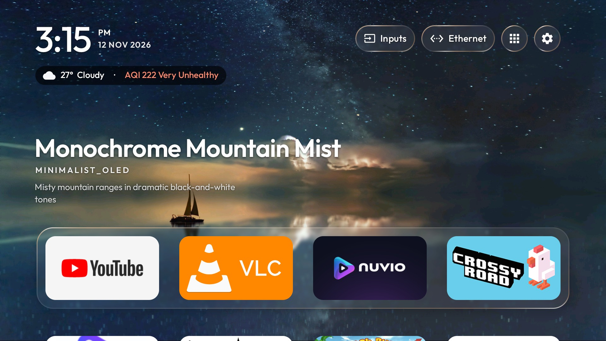<br>*Dark Minimalist (OLED)* |
| 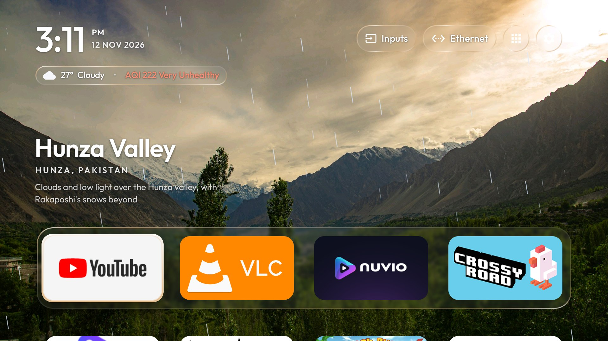<br>*Dynamic Weather: rain* | 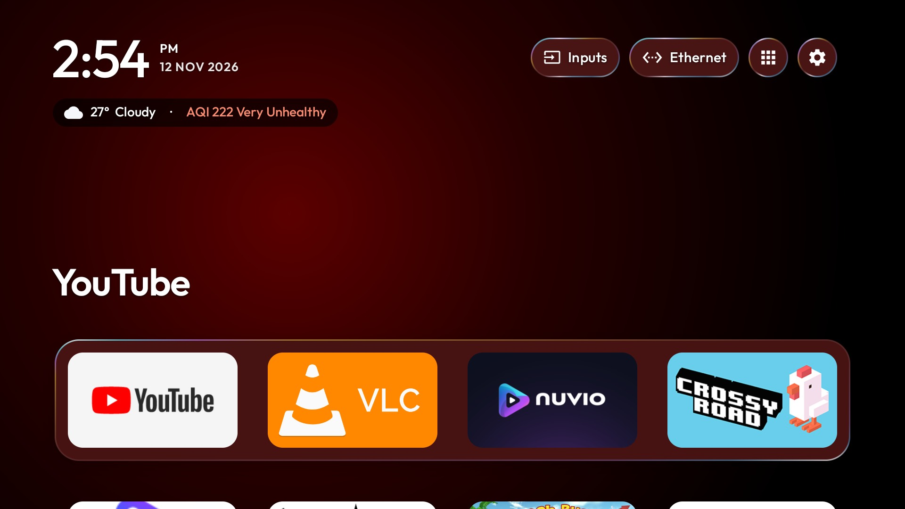<br>*No wallpaper* |
| 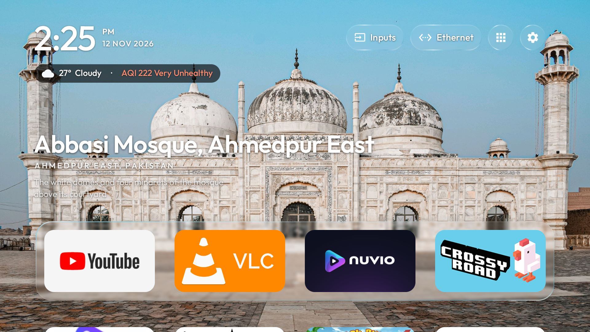<br>*Weather and AQI pill* | 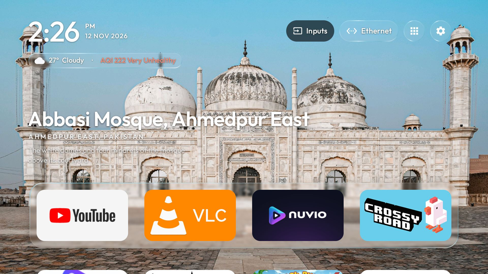<br>*Top bar* |
| 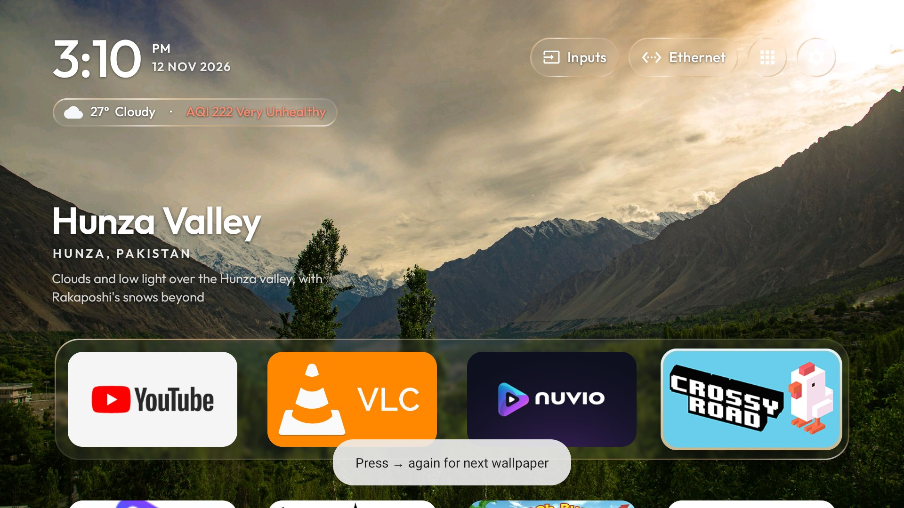<br>*Edge hint at the last dock tile* | 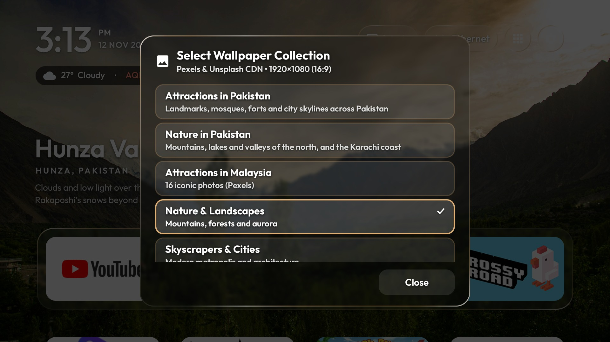<br>*Collections dialog* |
| <br>*Edge wallpaper switching* | <br>*Weather Effect Preview and location* |
| <br>*Weather Location* | <br>*App Color Glow* |
| 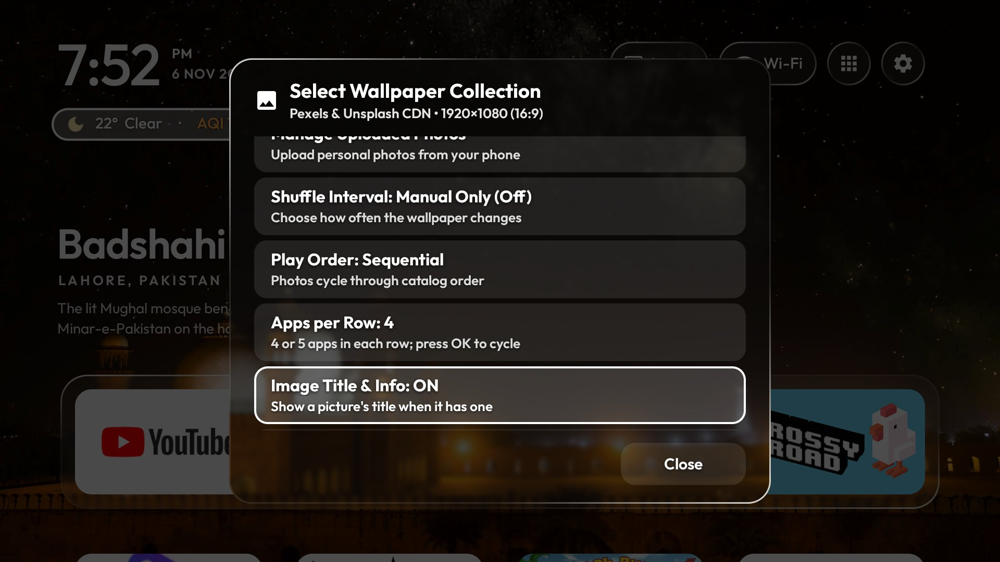<br>*Image Title & Info* | 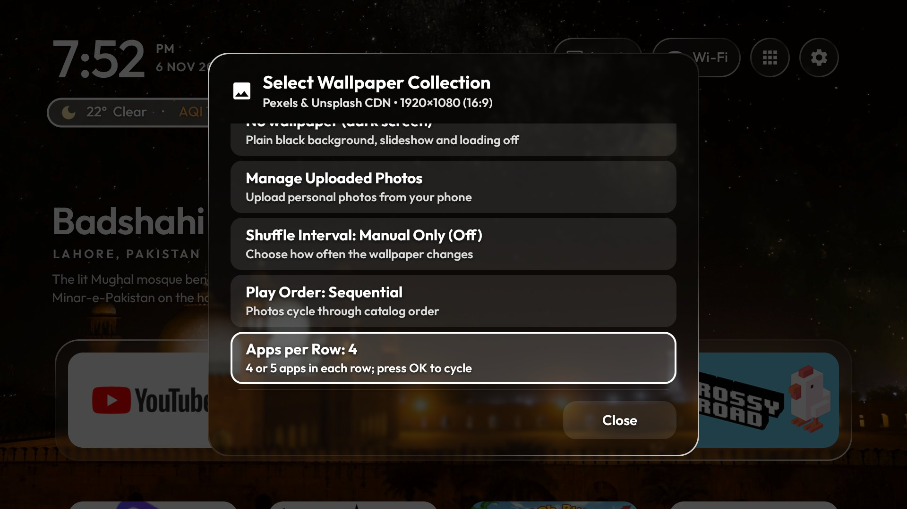<br>*Apps per Row* |

## What's new in 4.0.1

- **No wallpaper mode has a static neutral glare.** The dark screen's glass edge is one soft gray-white
  (`#DDE3EA`) chosen once when the mode is applied; it does not follow the focused app. **App Color Glow** is
  still the only thing that changes colour with focus there, and it is lighter on the TV while the edge stays put.
- **The glare no longer falls back to blue.** A gray or black-and-white picture, a very dark picture or a failed
  sample now gets a neutral shade picked from the picture's mean brightness (light gray-white on dark art, mid
  gray on bright art). Blue is only ever **Classic**, the fixed colour you choose, or a picture that really is blue.
- **The edge wallpaper switch is inactive in No wallpaper mode.** Right on the last dock tile and Left on the
  first are plain D-pad keys there: no toast, no two-second window, and none of the "explained twice per
  screen-on" allowance used up. Photo modes keep the switch exactly as before.
- **The glass focus and glare look is unchanged.** The static double ring on the focused tile, the prismatic rim
  on the dock, pills and panels, and the 450 ms app-colour glow are as they were in 4.0.0; the room glow now
  skips its cross-fade while focus is moving quickly and lands the last app's colour once.

## What's new in 4.0.0

### Look and feel

- **Glass focus ring and rim.** The focused app tile carries a static double ring: a white-to-tint gradient
  edge with a soft bloom and a top glint over the tile's 2 dp inner stroke. The dock tray, glass panels and
  top-bar pills share a thin prismatic edge with a window-light glint along the top. Both use cached shaders
  and add no animator or offscreen layer; the ring redraws on focus changes and the rim rebuilds only when the
  wallpaper tint changes.
- **Wallpaper-tinted glare.** One accent is sampled from the decoded wallpaper (a vivid, bright sample,
  brightened and with its saturation capped) and cached per file. It tints the glass edge and the selected
  tile's ring. **Glare Color** in the wallpaper settings offers **Auto (from wallpaper)**, the default, or
  **Classic** (the fixed blue). No wallpaper, a dark or gray photo, or a failed sample fell back to the
  classic blue in 4.0.0; 4.0.1 gives them a neutral shade instead.
- **Weather and AQI pill.** The combined weather/AQI pill focuses with a plain white glare border, not the
  AQI state colour and not the wallpaper tint, over the light translucent focused glass. The AQI state colour
  stays on the wording inside the pill.
- **Collection names.** The two Pakistan collections are now **Attractions in Pakistan** and **Nature in
  Pakistan**; the stored keys are unchanged, so a saved selection still opens the same collection. The
  Malaysia collection is **Attractions in Malaysia**.

### Wallpapers

- **Attractions in Pakistan and Nature in Pakistan** are separate collections in the wallpaper dialog: 24 and 10 photos,
  each with a measured day/night tone and credited below.
- **No wallpaper (dark screen)** is a plain black mode with its own App Color Glow switch (`app_color_glow_dark`),
  so the dark screen keeps its glow choice when the picture mode changes.
- **Image Title & Info**: when on, the shelf shows a picture's title, place and description if it has one. A photo
  without a title (sent from a phone, uploaded, or pinned) shows the focused app's name. When off, every mode
  shows the app's name.
- **Uploads are normalised once.** A phone photo, upload or pinned file is read for bounds, rotated by EXIF,
  sampled to this screen and centre-cropped to 16:9, then stored as one opaque JPEG (quality 90). The original is
  untouched; photos below 1280×720 are not enlarged; the copy is rebuilt if the file changes and removed on delete.

### Day/Night

- **Day/Night Wallpapers** is the toggle right under Change Wallpaper Now. It uses the TV clock at every change,
  06:00–18:00 for day and 18:00–06:00 for night, and always keeps at least five photos in a period by adding the
  nearest by brightness.

### Edge switch

- **Edge Wallpaper Switch** (default on) changes the wallpaper when you double-press Right at the last dock tile
  or Left at the first. The second press has a two-second window; any other key cancels.
- The system toast says "Press → again for next wallpaper" or "Press ← again for previous wallpaper". Each
  direction is explained twice per screen-on; the counters refill after the screen goes off and on, and on a
  fresh launch.

### Weather effects

- **Dynamic Weather** draws drizzle, rain, showers and thunderstorms as distinct effects, and drifting fog from
  WMO codes 45/48 or visibility below 1,000 m. Fog thickens as visibility drops, is neutral grey-white, sits below
  the clock, title and dock, and fades in and out over 1.5 s at no more than 30 fps.
- **No wallpaper (dark screen) shows no weather effects.** The dark mode draws no overlay of any kind, rain or fog,
  and keeps its own App Color Glow switch instead.
- **Weather Effect Preview** cycles with OK: Auto, Drizzle, Rain, Thunderstorm, Light fog, Heavy fog. The chosen
  effect is what the real classifier and renderer would paint, stays for ten minutes or until Auto, and is kept in
  memory only. With Dynamic Weather off, the row reads "Off" and names the pending choice.

### Weather location

- **Weather Location** searches cities through Open-Meteo geocoding (city, region, country), keeps the Lahore
  default, or detects this TV's city with one ipwho.is request from its public IP. The detected city is shown for
  confirmation before anything is saved.
- Latitude, longitude, display name and timezone are stored, and weather/AQI caches are keyed by location. The
  Malaysian JAS/APIMS station is used only within about 80 km of the chosen point; Open-Meteo's US AQI is used
  everywhere else.

### VPN

- The network menu's **VPN** row opens any installed app that publishes an `android.net.VpnService` (Proton VPN
  here), using its leanback or normal launch intent. With several candidates the launcher shows which one it
  opened; with none it says "No VPN app installed".
- While any VPN transport is up, the network pill shows a small green **VPN** chip. Usage access is only read, never
  requested, and the row is a shortcut, not an on/off switch.

### App glow

- The wallpaper glows in the focused app's colour from a radial shape at 32% across and 42% down, fading out by
  62% of the width. The white shape is rasterised at screen size (capped at 1920×1080) and tinted per app.
- **App Color Glow** turns it off and on per mode; off means no glow and no glow work. Focus changes cross-fade
  over 450 ms.

### Settings

- **Apps per Row** cycles 4 → 5 → 4, stores the choice in `wallpaper_prefs` (`grid_columns`), rebuilds Home and
  keeps the wallpaper and focus. A stored six becomes five on first start.
- The power rows open the system power dialog; the Screensaver row starts the TV's own screensaver. The interface
  is English only.

### Display quality

- A 1080p-or-smaller panel, a low-RAM TV, or a 4K panel without enough heap keeps the original 2560×1440
  downloads and decode. A 4K panel with room requests 3840×2160 where the source exists, decodes up to that size,
  never upscales a smaller original, and uses a 96 MB cache keyed by URL so tiers never mix.

### Send a wallpaper from your phone

- **A redesigned, self-contained phone page.** The TV serves one HTML file with no external assets (only the
  footer's GitHub link); all names are written as text, never as markup.
- **Up to 10 photos at once.** The page uploads them one at a time in a queue, with a "2 of 5" counter, per-photo
  progress and state, Cancel for the rest, and Try again on a single failed photo. The last successful photo is
  the one on the TV.
- **The list is clearer.** Rows show "Photo · 6 Nov, 18:46" and the size on one line, with 44 px icon-only Lock and
  Delete buttons; the delete sheet shows the full stored file name. Select mode adds checkboxes, Select all,
  Delete (n), a count-aware confirmation and Done. "Cycle all photos" appears only while a photo is locked.
- **The QR session stays open.** Applying a wallpaper no longer closes the QR dialog or stops the server. It stays
  live until Close/Back on the TV or ten minutes with no request, and every request resets the clock.
- **A lost response is not a failure.** If an upload finishes but the reply is lost, the page checks `/api/list`
  and treats the photo as sent when it appears; the error appears only when it does not.
- **Sent photos are named.** A photo with no catalogue title shows the focused app's name in the shelf, in the same
  block the dark screen uses.
- **Large, small and odd-ratio photos are smooth.** The normalised copy described above is reused, and low-res
  photos are never enlarged.

## Send a wallpaper from your phone

1. On the TV open **Wallpaper → Manage Uploaded Photos → Open QR Code**.
2. Scan the QR with a phone on the same Wi-Fi. The page opens at the TV's local address.
3. Pick up to 10 photos and send. They upload one at a time; the page shows the queue and the result for each.
4. On the page you can lock one photo, cycle all photos, delete one, or use **Select** to delete several. The TV
   applies each photo immediately.
5. Leave the QR window open for more photos. Closing it, or ten idle minutes, stops the server and frees the port.

## Install

**Download** [glasstv-4.0.1-signed.apk](https://github.com/5uleman/glass-tv-home/releases/download/v4.0.1/glasstv-4.0.1-signed.apk)
from the [v4.0.1 release](https://github.com/5uleman/glass-tv-home/releases/tag/v4.0.1).
It is 691,149 bytes (675 KB), package `com.suleman.glasstv`, version **4.0.1 (27)**.

SHA-256:

```
bfc54cef82bb4023957c2c13b9617132a8390fae85722016e7acd3ada161ceba
```

```bash
adb install -r glasstv-4.0.1-signed.apk
```

No computer? Copy the APK to a USB drive or download it with a file manager on the TV, open it, and allow installs
from that app. The launcher has its own package id and signing key, so it installs beside upstream's build instead
of updating it. If a debug build of this fork is already installed, uninstall it first.

**Requirements:** Android TV or Google TV, Android 8 or newer (`minSdk 26`). Any 720p, 1080p or 4K panel. LG (webOS)
and Samsung (Tizen) TVs cannot run an Android launcher; an Android TV box in an HDMI port gives them the full app.

**Verify the download:**

```bash
# Linux or macOS
sha256sum glasstv-4.0.1-signed.apk

# Windows (Command Prompt or PowerShell)
certutil -hashfile glasstv-4.0.1-signed.apk SHA256
```

The output must start with `bfc54cef…`.

**First run.** Two TV-side steps make the launcher complete:

1. Turn on the **Home button** accessibility service (Settings → Accessibility → Glass TV → Home button). It is
   needed for the recent-apps deck and the power rows, and some TVs reset it after a reboot or update. The launcher
   repairs the binding itself when the service was already on and the grant exists; check it with
   `adb shell dumpsys accessibility | grep -i bound`.
2. Grant the cache-cleaning permission once:
   `adb shell pm grant com.suleman.glasstv android.permission.WRITE_SECURE_SETTINGS`

Then disable the stock launcher **instead of uninstalling it**, so the TV can be put back exactly as it was. The
restore notes and per-model guidance are in [docs/CLEANYOURTV-README.md](docs/CLEANYOURTV-README.md) and
[docs/DEVICES.md](docs/DEVICES.md).

## Privacy and network

- **Weather and AQI:** Open-Meteo forecast, air-quality and geocoding APIs.
- **City detection:** one ipwho.is request from the TV's public IP, only when you press Detect, and only shown for
  confirmation before it is saved.
- **Weekly places:** Bing's home-page picture feed.
- **Wallpaper catalogues:** Pexels, Unsplash and Wikimedia Commons image hosts.
- **Malaysian air quality:** the JAS/APIMS station is queried only when the chosen point is within about 80 km of
  one; elsewhere the AQI comes from Open-Meteo.
- **Not contacted in this build:** the prayer and Azan endpoints (`api.waktusolat.app`, `api.quran.com`, the
  archive.org azan recordings) and the GitHub update feed. Prayer is disabled and the self-updater is off.
- **The phone upload server:** it listens on the TV's local Wi-Fi address at `http://<tv-ip>:8080` (fallback
  `8888`) only while the QR dialog is open. It has no account or token, it is HTTP on your own network, and it
  stops when the dialog closes or after ten minutes with no request. Uploaded photos stay in the app's private
  storage on the TV; nothing is sent to a cloud service.
- No ads, analytics or tracking.

## Build from source

Requirements: JDK 17 to 21 (built here with JDK 21) and Android SDK platform 34. Newer JDKs, such as 25, are
rejected by the Gradle 8.9 and Android Gradle plugin versions this project uses.

```bash
cd launcher
./gradlew clean :app:test :app:assembleRelease --rerun-tasks
```

The release APK lands in `launcher/app/build/outputs/apk/release/app-release.apk`. Run only the unit tests with:

```bash
cd launcher
./gradlew :app:testDebugUnitTest
```

CI runs the tests and the release build and fails if the APK grows past 716,800 bytes; this build is 691,149 bytes.

## Credits

- **[glass-tv-home](https://github.com/aqmangge/glass-tv-home) by Gathin ([@aqmangge](https://github.com/aqmangge))** —
  the original project this fork is built on, MIT licence. Thank you for the dock, the weekly places, the upload
  page and the rest of the foundation.
- **[CleanYourTV](https://github.com/Gathin23/cleanyourtv)** by Gathin — the debloat lists, tools and launcher that
  the original project grew from, MIT licence. The full upstream history is kept in this repository.
- The glass rim and the tile focus ring are ported from [glass-tv-home](https://github.com/aqmangge/glass-tv-home):
  `GlassRim.java` and the drawing in `DockBreathingBorderView.java`, plus the focused shapes in `tile_bg.xml`
  and `pill_bg.xml`. MIT licence, © 2026 Gathin. This fork holds the ring at rest (no breathing animator) and
  adds the wallpaper tint.
- The **Outfit** typeface is under the SIL Open Font License (`launcher/FONT-LICENSE-OFL.txt`).
- The Inputs icon is from Google's Material Icons (Apache 2.0).
- Pictures of places and their captions are Bing's daily images (Microsoft). The launcher fetches them on your own
  TV.
- "Cyberpunk Neon Night" in the city collection — Cash Macanaya
  ([photo](https://unsplash.com/photos/a-city-at-night-with-neon-signs-and-buildings-kUpA8qN28GE)).
- The Pakistan wallpaper collections use photos from Pexels and Unsplash, free under their licences, and CC BY or
  CC BY-SA files from Wikimedia Commons with the licence named on each line. Photographers and authors, in the
  order each collection lists them:
  - **Attractions in Pakistan** (24 photos)
    - Badshahi Mosque — Aitizaz Naqvi (Pexels licence, [photo](https://www.pexels.com/photo/5487986/))
    - Alamgiri Gate, Lahore Fort — Salman Rafique (Pexels licence, [photo](https://www.pexels.com/photo/11774127/))
    - Lahore at night — Wasif Mehmood (Pexels licence, [photo](https://www.pexels.com/photo/16021536/))
    - Islamabad from above — Ahmed Ismail (Pexels licence, [photo](https://www.pexels.com/photo/38773558/))
    - Karachi at night — Tahamie Farooqui (Pexels licence, [photo](https://www.pexels.com/photo/34096455/))
    - Karachi skyline — Tahamie Farooqui (Pexels licence, [photo](https://www.pexels.com/photo/33045005/))
    - Derawar Fort — Syed Hasan Mehdi (Pexels licence, [photo](https://www.pexels.com/photo/815880/))
    - Makli Necropolis — Ayesha Memon (Pexels licence, [photo](https://www.pexels.com/photo/34535290/))
    - Lahore Fort — Mian Rizwan (Pexels licence, [photo](https://www.pexels.com/photo/14926132/))
    - Minar-e-Pakistan — Aatik Ali Makani (Pexels licence, [photo](https://www.pexels.com/photo/13239874/))
    - Pakistan Monument — Hamza Ali (Pexels licence, [photo](https://www.pexels.com/photo/14394126/))
    - Abbasi Mosque, Ahmedpur East — Ammar Hameed (Pexels licence, [photo](https://www.pexels.com/photo/31377718/))
    - Badshahi Mosque — salman kazmi (Pexels licence, [photo](https://www.pexels.com/photo/12912453/))
    - Tooba Masjid — Virwani1 (CC BY-SA 4.0, [file](https://commons.wikimedia.org/wiki/File:Tooba_Masjid.jpg))
    - Hazuri Bagh Baradari — ClicksByMohammadOmer (CC BY-SA 3.0, [file](https://commons.wikimedia.org/wiki/File:The_Scenic_Hazuri_Bagh_Baradari.jpg))
    - Faisal Mosque — Abdul Ahad (Pexels licence, [photo](https://www.pexels.com/photo/38383016/))
    - Mohatta Palace — Ibrahim Janjua (CC BY-SA 4.0, [file](https://commons.wikimedia.org/wiki/File:Mohatta_Palace_2016.jpg))
    - Lahore Railway Station — Filmy Kashif (Pexels licence, [photo](https://www.pexels.com/photo/35734282/))
    - Grand Jamia Mosque — Ammarsharif17 (CC BY-SA 4.0, [file](https://commons.wikimedia.org/wiki/File:Grand_Jamia_Masjid.jpg));
      the photograph is in Bahria Town, Lahore
    - Grand Jamia Mosque — HR Capture (Pexels licence, [photo](https://www.pexels.com/photo/23961877/));
      the photograph is in Bahria Town, Lahore
    - Badshahi Mosque — M1DDL3 M7N (Pexels licence, [photo](https://www.pexels.com/photo/14406067/))
    - Frere Hall — Ibrahim Janjua (CC BY-SA 4.0, [file](https://commons.wikimedia.org/wiki/File:Frere_Hall_Karachi_City.jpg))
    - Mazar-e-Quaid — Furqanlw (CC BY-SA 4.0, [file](https://commons.wikimedia.org/wiki/File:Mazar-e-Quaid_Karachi.jpg))
    - Old Tollinton Market — Shairyar Khan (Unsplash licence, [photo](https://unsplash.com/photos/a-large-building-with-a-clock-tower-on-top-of-it-l_lGkl0M6r8))
  - **Nature in Pakistan** (10 photos)
    - Rawal Lake — Ashraf Hussain (Pexels licence, [photo](https://www.pexels.com/photo/38459967/))
    - Clifton Beach — Muneeb Khan (Pexels licence, [photo](https://www.pexels.com/photo/28244078/))
    - Hunza valley in autumn — Wasif Mehmood (Pexels licence, [photo](https://www.pexels.com/photo/19442083/))
    - Hunza Valley — Wasif Mehmood (Pexels licence, [photo](https://www.pexels.com/photo/15916726/))
    - Golden peaks of Hunza — Arif Esapzai (Pexels licence, [photo](https://www.pexels.com/photo/35302563/))
    - Passu Cones — Raj Kumar Lohana (Pexels licence, [photo](https://www.pexels.com/photo/8835247/))
    - Attabad Lake — Hamayoon Riaz (Pexels licence, [photo](https://www.pexels.com/photo/13462643/))
    - Nanga Parbat at sunrise — Maaz Kalia (Pexels licence, [photo](https://www.pexels.com/photo/29401243/))
    - Swat Valley — Tahir Shaw (Pexels licence, [photo](https://www.pexels.com/photo/186985/))
    - Karakoram peaks — Pierre Matile (Pexels licence, [photo](https://www.pexels.com/photo/36870354/))
- Gotham, used in upstream's promo pictures only, is a Hoefler&Co. typeface and is not part of this repository.
- Weather and geocoding by [Open-Meteo](https://open-meteo.com/), free and keyless.
- `tools/tag-photo.ps1` measures a wallpaper's pixel size and Rec.601 luma and prints its DAY, NIGHT or BOTH tag.
- Fork maintained by **[5ULEMAN](https://github.com/5uleman)**.

## Licence

[MIT](LICENSE) — original work © 2026 Gathin; fork changes © 2026 5ULEMAN. The upstream licence and notices are
kept in [LICENSE](LICENSE) and [launcher/FONT-LICENSE-OFL.txt](launcher/FONT-LICENSE-OFL.txt).
