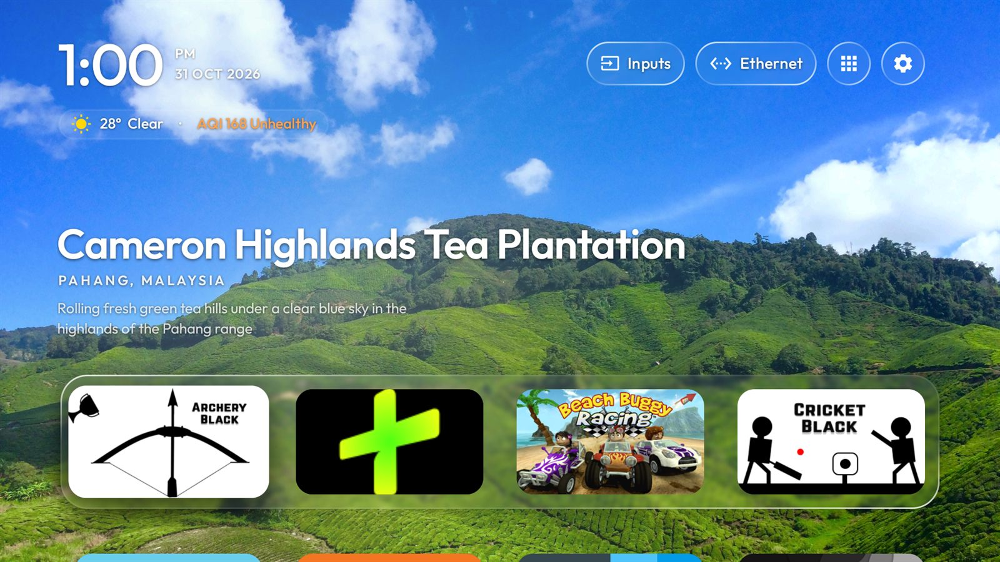
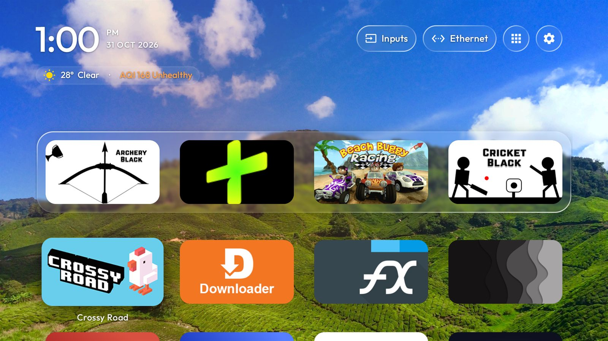
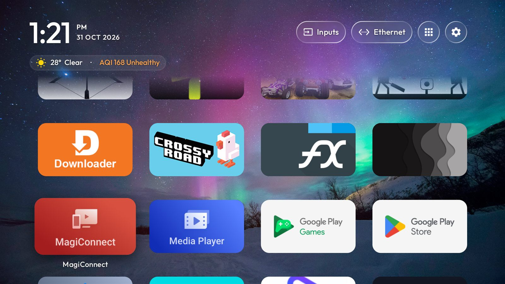
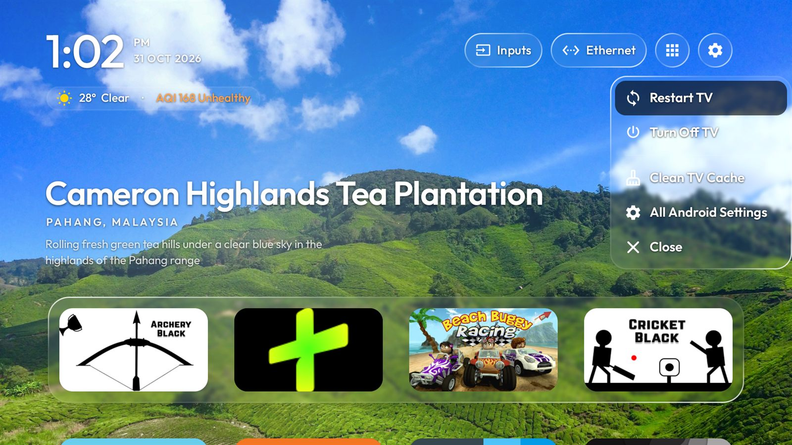
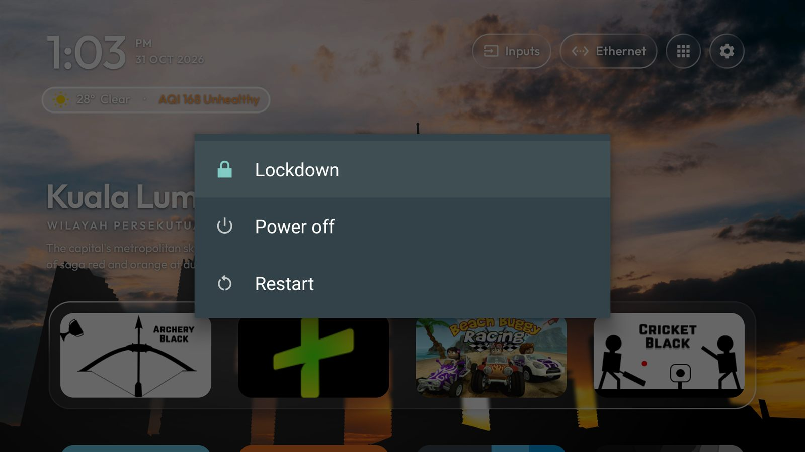

# Glass TV — Clean English Edition

> **Fork note.** This is a modified fork of [Gathin's glass-tv-home](https://github.com/aqmangge/glass-tv-home),
> used under its MIT licence — see [LICENSE](LICENSE). It is a hobby fork: there is no support promise, and it is
> not endorsed by or affiliated with the original author.

This is a modified version of Gathin's glass-tv-home, made by Suleman for English use, with some features
removed for a cleaner experience.

A light home screen for Android TV and Google TV in frosted glass, with a new set of places behind your apps
every week. This edition is the English-UI, prayer-free build I use on my own TV, with Lahore as the default
city.

## Download

The current build is **3.7.0** (`versionCode 24`), 661,445 bytes (646 KB), package id
**`com.suleman.glasstv`**. Download it from the
[Releases page](https://github.com/5uleman/glass-tv-home/releases/latest) — release binaries are
attached there, not committed to this repository.

SHA-256 (`glasstv-3.7.0-signed.apk`): `366ab333c0b19d2a52ca102ad5db08bf54884701483f27788f0a1bc9b7c29708`

> The APKs still under `release/` (`glass-tv-home.apk`, `glass-tv-installer.apk`) are upstream's original
> builds, kept for reference. Do not install them as this edition — use only the Releases page.

```bash
adb install -r glasstv-3.7.0-signed.apk
```

The APK is signed with this fork's own key, so it will not install over the original author's build (different
package id, different signature) and does not install over a debug build of this fork. Uninstall the old one
first if the package ids collide.

Everything is reversible: the launcher is a normal app, and it never roots the TV or changes system firmware.

## What is different in this edition

- **English only.** Whatever language the TV is set to, the interface stays English.
- **Prayer and azan features are off.** No prayer timetable, no azan popup, no Islamic shelf, no Hijri or
  next-prayer rows in the nightstand clock.
- **Lahore is the default location** (station `PK01`, Asia/Karachi) for the weather pill. A location you set on
  the TV still wins over the default.
- **One Turn Off / Restart row** in the gear menu opens the system power dialog, where the TV itself offers
  Power off or Restart.
- **A Screensaver row** in the gear menu starts the TV's own screensaver. Any key dismisses it.
- **A VPN chip.** While any VPN is connected, the network pill shows a small green "VPN" chip. The network
  menu has a VPN row that opens the Proton VPN app if it is installed, and otherwise says it is missing. It is
  only a shortcut: there is no on/off switch, because Android does not let a launcher control another VPN app.
- **Two Pakistan wallpaper collections.** *Pakistan Monuments* has 24 photos of Lahore, Islamabad,
  Karachi, the forts and the mosques; *Pakistan Nature* has 10 photos of the Hunza valley, Attabad
  Lake, Nanga Parbat, Swat, the Karakoram, Rawal Lake and Clifton Beach. Credits are below.
- **Day/night wallpaper rotation.** Every catalog photo in every online collection carries a measured brightness
  and a day, night or both tag. With **Day/Night Wallpapers** on (the default, right under Change Wallpaper
  Now), 06:00-18:00 rotates day and both photos, and 18:00-06:00 rotates night and both photos, checked by the
  TV clock at every change. A period always keeps at least five photos, adding the nearest by brightness if
  needed. Uploaded photos and a single pinned wallpaper are never filtered.
- **Rain and fog overlays.** **Dynamic Weather** (default On, same stored key) keeps the rain,
  drizzle, showers and thunderstorm animation and adds drifting fog. Fog comes from WMO codes 45/48
  or visibility below 1,000 m in the existing Open-Meteo request, and thickens as visibility drops
  from 1,000 m to 200 m; a code with no visibility gives a medium veil. Rain wins over fog. The fog
  is three neutral white layers of seamless procedural noise drifting at different speeds (a screen
  width in 100-170 s), weighted to the lower part of the screen and faded out toward the top, at a
  hard 52% opacity cap, so it only lightens and never dims or tints the wallpaper, pills or tiles.
  The 1024x256 texture is built once in the background, about 1 MB, with no bundled image; the
  effect fades in and out over 1.5 s and is a little lighter at night (06:00-18:00 is day). It draws
  only while Home is in front, at no more than 30 fps, and sits below the clock, title and dock.
  A bad AQI stays in the text pill and never paints the wallpaper. Long-press **OK** on the Dynamic
  Weather row to preview Rain, light Fog and heavy Fog for 5 s each; a short press still switches the
  setting On or Off.
- **Weather Location.** A row under Dynamic Weather, in both the wallpaper settings and the settings
  card, sets the place that weather, AQI and the wallpaper effects follow. Search by city through
  Open-Meteo geocoding (each result shows city, region and country), use the Lahore default, or
  detect this TV's city with one ipwho.is request from its public IP (free, no key, 1,000 requests
  per day per client IP), shown for confirmation before anything is saved. Latitude, longitude,
  display name and timezone are stored; weather and AQI caches are keyed by location, so one city's
  figures never appear under another; the Malaysian JAS/APIMS station is used only within its old
  ~80 km of the chosen point, and Open-Meteo's US AQI everywhere else.
- **Wallpaper quality by display.** A 1080p-or-smaller panel, a low-RAM TV, or a 4K panel whose heap
  cannot hold two 4K bitmaps plus the blur copies keeps the original 2560x1440 downloads and decode.
  A 4K panel with enough heap requests 3840x2160 from Pexels, Unsplash and the six Commons photos
  whose originals are at least 3840 wide; it decodes up to 3840x2160 and never upscales a smaller
  original. The 4K cache is capped at 96 MB, and cache files are keyed by URL so tiers never mix;
  after a tier change the old tier's files are pruned once the new ones arrive.
- **A glass wallpaper dialog.** The category list is frosted glass with a white focus ring, and a dark smoke
  layer keeps the white text readable over bright pictures.
- **A recent-apps deck.** Double-press Home. Cards scroll horizontally in 16:9, using each app's TV
  banner (or a large icon and the name on a glass card); **Up** closes the focused app, **OK** opens it,
  **Down** moves to Clear all, and **Back** closes the deck. A live RAM meter updates about once a second.
  **Clear all only ends background processes**, so the memory freed may be small; it never force-stops an
  app. The launcher, system and persistent apps, the keyboard, accessibility services and a connected VPN are
  left alone, and the deck says when a VPN was kept.
- **The self-updater is off.** This build never reads a release feed or shows an update prompt; new versions are
  built and installed by hand.
- **Four-column grid** and a hero title that uses the full width, so a long place name is not cut with an
  ellipsis.
- **Media polling is off**, so nothing polls the current track while the launcher is idle.

Everything else is upstream's work: the glass dock and menus, weekly places, the StandBy clock, cache cleaning
every 15 days, wallpaper themes and the phone QR upload.

## Setup on the TV

Install the APK, then three things have to be done by hand (and the accessibility service again after every
install or update):

1. **Turn on the "Home button" accessibility service**: Settings → Accessibility → Glass TV → "Home button" → On.
   **This has to be done again after every install or update.** Double-pressing Home to open the recent-apps
   deck and the Turn Off / Restart row need it. Press Home afterwards and check it is bound:
   `adb shell dumpsys accessibility | grep -i bound`. If it is not bound, firmware that blocks service
   auto-start is the usual reason, and the power row will only show a hint pointing at that switch.

   **This has to be checked after every reboot on some TVs.** On the TCL set this build was tested on, the TV
   resets the accessibility master switch at boot: `adb shell settings get secure accessibility_enabled` reads `0`,
   the service stays listed but is not bound, and Turn Off / Restart only offers to open the Accessibility
   screen.

   **From 3.3.1 the launcher repairs this itself.** When it starts and finds the grant from step 2, our service
   still in `enabled_accessibility_services`, and the service not bound, it sets the master switch back to 1 and
   rewrites the list (removing and re-adding our entry, keeping every other service) so Android rebinds it. It
   never enables a service you had not turned on earlier. Check what it did with
   `adb logcat -d -s TvHome.HomeKey | grep 'a11y repair'`, then confirm the binding with
   `adb shell dumpsys accessibility | grep -i 'bound services'` — it must list `Service[label=Home button…]`.

   If the repair cannot run (no grant, or the service was never enabled), do it by hand: Settings →
   Accessibility → Glass TV → Home button → On, then check the binding again. Over adb it takes three commands,
   because setting the master switch alone does not rebind:
   ```bash
   adb shell settings put secure accessibility_enabled 1
   adb shell settings put secure enabled_accessibility_services ""
   adb shell settings put secure enabled_accessibility_services com.suleman.glasstv/com.gathin.tvhome.HomeKeyService
   ```

   **An install or update clears this again on this TV.** Replacing the APK over the old one left
   `enabled_accessibility_services` empty and the switch at `0`, and the launcher does not opt you back in, so
   turn the "Home button" service back on in Settings after every install or update.
2. **Grant one permission for the cache cleaning**:
   ```bash
   adb shell pm grant com.suleman.glasstv android.permission.WRITE_SECURE_SETTINGS
   ```
3. **Disable the stock launcher, never uninstall it**, so the TV can be put back exactly as it was:
   ```bash
   adb shell pm disable-user --user 0 <stock launcher package>
   ```
   Find that package with `adb shell cmd package query-activities --brief -a android.intent.action.MAIN -c
   android.intent.category.HOME`, or let `launcher/build-and-install.sh` do install, Home selection and the
   launcher swap with its own rollback if anything fails.

Debloating is optional and separate from this launcher. The playbook, tested lists and scripts for it are in
[docs/CLEANYOURTV-README.md](docs/CLEANYOURTV-README.md), with per-model notes in
[docs/DEVICES.md](docs/DEVICES.md) and [examples/](examples/).

## Screenshots

Taken from this edition on a TCL Android TV (Android 11, 1080p).

| | |
|---|---|
|  |  |
| *Home, with this week's place* | *The dock and the app grid behind it* |
|  |  |
| *Every app, four columns* | *The quick settings menu* |
|  | |
| *Turn Off / Restart opens the system power dialog* | |

## Which TVs work

Android TV or Google TV, Android 8 or newer (`minSdk 26`), on the TV or on a box plugged into any TV.
[docs/DEVICES.md](docs/DEVICES.md) lists every model upstream has tested and how far each was tested.

LG (webOS) and Samsung (Tizen) TVs cannot run it: neither lets an app replace the home screen or the Home
button. A Google TV or Android TV stick or box in an HDMI port gives you the full launcher on those screens.

## Building it yourself

Needs JDK 17 (or newer) and Android SDK platform 34 with build-tools 34.0.0:

```bash
cd launcher
./gradlew testReleaseUnitTest assembleRelease
```

The release APK lands in `launcher/app/build/outputs/apk/release/app-release.apk`. CI runs the same two tasks
and fails if the APK grows past 700 KB.

Release signing is optional. Copy [launcher/keystore.properties.example](launcher/keystore.properties.example)
to `launcher/keystore.properties` (gitignored), point `storeFile` at a keystore outside the repository and fill
in the passwords; without that file the build falls back to the debug key, which is what CI uses.

## Adding a wallpaper photo

1. Add the URL exactly as the app should request it (the `w=2560&h=1440&fit=crop` pattern, or the Commons
   thumbnail width) to `CURATED_CATALOG` in
   [OnlineWallpapers.java](launcher/app/src/main/java/com/gathin/tvhome/OnlineWallpapers.java), with its title,
   description and collection.
2. Measure it with the same method as the catalog:
   `powershell -File tools/tag-photo.ps1 "<url>"`.
   The script downloads the exact URL with the app's user agent and prints HTTP status, content type, pixel
   size, KB, the Rec.601 mean luma, and `DAY` (>= 115), `NIGHT` (<= 85) or `BOTH`.
3. Put that luma and the explicit tone on the entry. Review sunset, sunrise, indoor and neutral scenes by eye;
   the measured tag is a starting point, not a substitute for looking at the picture.
4. Run the tests. The catalog test fails if any entry has no measured luma or no explicit tag, so a photo
   cannot be added without tagging it.

## Credits and licence

- Built on [CleanYourTV](https://github.com/Gathin23/cleanyourtv) © 2026 Gathin, MIT licence — see
  [LICENSE](LICENSE). Its debloat lists, tools and launcher are the foundation of this project, and this fork
  keeps the full [upstream history](https://github.com/aqmangge/glass-tv-home).
- The Outfit typeface is under the SIL Open Font License (`launcher/FONT-LICENSE-OFL.txt`).
- The Inputs icon is from Google's Material Icons (Apache 2.0).
- Pictures of places and their captions are Bing's daily images (Microsoft). The launcher fetches them on your
  own TV; any promo or screenshot pictures in this repository show three of them.
- "Cyberpunk Neon Night" in the city collection — Cash Macanaya ([photo](https://unsplash.com/photos/a-city-at-night-with-neon-signs-and-buildings-kUpA8qN28GE)).
- The Pakistan wallpaper collections use photos from Pexels and Unsplash, free under their licences, and
  CC BY or CC BY-SA files from Wikimedia Commons with the licence named on each line. Photographers and
  authors, in the order each collection lists them:
  - **Pakistan Monuments** (24 photos)
    - Badshahi Mosque — Aitizaz Naqvi (Pexels licence, [photo](https://www.pexels.com/photo/5487986/))
    - Alamgiri Gate, Lahore Fort — Salman Rafique (Pexels licence, [photo](https://www.pexels.com/photo/11774127/))
    - Lahore at night — Wasif Mehmood (Pexels licence, [photo](https://www.pexels.com/photo/16021536/))
    - Islamabad from above — Ahmed Ismail (Pexels licence, [photo](https://www.pexels.com/photo/38773558/))
    - Karachi at night — Tahamie Farooqui (Pexels licence, [photo](https://www.pexels.com/photo/34096455/))
    - Karachi skyline — Tahamie Farooqui (Pexels licence, [photo](https://www.pexels.com/photo/33045005/))
    - Derawar Fort — Syed Hasan Mehdi (Pexels licence, [photo](https://www.pexels.com/photo/815880/))
    - Makli Necropolis — Ayesha Memon (Pexels licence, [photo](https://www.pexels.com/photo/34535290/))
    - Lahore Fort — Mian Rizwan (Pexels licence, [photo](https://www.pexels.com/photo/14926132/))
    - Minar-e-Pakistan — Aatik Ali Makani (Pexels licence, [photo](https://www.pexels.com/photo/13239874/))
    - Pakistan Monument — Hamza Ali (Pexels licence, [photo](https://www.pexels.com/photo/14394126/))
    - Abbasi Mosque, Ahmedpur East — Ammar Hameed (Pexels licence, [photo](https://www.pexels.com/photo/31377718/))
    - Badshahi Mosque — salman kazmi (Pexels licence, [photo](https://www.pexels.com/photo/12912453/))
    - Tooba Masjid — Virwani1 (CC BY-SA 4.0, [file](https://commons.wikimedia.org/wiki/File:Tooba_Masjid.jpg))
    - Hazuri Bagh Baradari — ClicksByMohammadOmer (CC BY-SA 3.0, [file](https://commons.wikimedia.org/wiki/File:The_Scenic_Hazuri_Bagh_Baradari.jpg))
    - Faisal Mosque — Abdul Ahad (Pexels licence, [photo](https://www.pexels.com/photo/38383016/))
    - Mohatta Palace — Ibrahim Janjua (CC BY-SA 4.0, [file](https://commons.wikimedia.org/wiki/File:Mohatta_Palace_2016.jpg))
    - Lahore Railway Station — Filmy Kashif (Pexels licence, [photo](https://www.pexels.com/photo/35734282/))
    - Grand Jamia Mosque — Ammarsharif17 (CC BY-SA 4.0, [file](https://commons.wikimedia.org/wiki/File:Grand_Jamia_Masjid.jpg));
      the photograph is in Bahria Town, Lahore
    - Grand Jamia Mosque — HR Capture (Pexels licence, [photo](https://www.pexels.com/photo/23961877/));
      the photograph is in Bahria Town, Lahore
    - Badshahi Mosque — M1DDL3 M7N (Pexels licence, [photo](https://www.pexels.com/photo/14406067/))
    - Frere Hall — Ibrahim Janjua (CC BY-SA 4.0, [file](https://commons.wikimedia.org/wiki/File:Frere_Hall_Karachi_City.jpg))
    - Mazar-e-Quaid — Furqanlw (CC BY-SA 4.0, [file](https://commons.wikimedia.org/wiki/File:Mazar-e-Quaid_Karachi.jpg))
    - Old Tollinton Market — Shairyar Khan (Unsplash licence, [photo](https://unsplash.com/photos/a-large-building-with-a-clock-tower-on-top-of-it-l_lGkl0M6r8))
  - **Pakistan Nature** (10 photos)
    - Rawal Lake — Ashraf Hussain (Pexels licence, [photo](https://www.pexels.com/photo/38459967/))
    - Clifton Beach — Muneeb Khan (Pexels licence, [photo](https://www.pexels.com/photo/28244078/))
    - Hunza valley in autumn — Wasif Mehmood (Pexels licence, [photo](https://www.pexels.com/photo/19442083/))
    - Hunza Valley — Wasif Mehmood (Pexels licence, [photo](https://www.pexels.com/photo/15916726/))
    - Golden peaks of Hunza — Arif Esapzai (Pexels licence, [photo](https://www.pexels.com/photo/35302563/))
    - Passu Cones — Raj Kumar Lohana (Pexels licence, [photo](https://www.pexels.com/photo/8835247/))
    - Attabad Lake — Hamayoon Riaz (Pexels licence, [photo](https://www.pexels.com/photo/13462643/))
    - Nanga Parbat at sunrise — Maaz Kalia (Pexels licence, [photo](https://www.pexels.com/photo/29401243/))
    - Swat Valley — Tahir Shaw (Pexels licence, [photo](https://www.pexels.com/photo/186985/))
    - Karakoram peaks — Pierre Matile (Pexels licence, [photo](https://www.pexels.com/photo/36870354/))
- Gotham, used in upstream's promo pictures only, is a Hoefler&Co. typeface and is not part of this repository.
